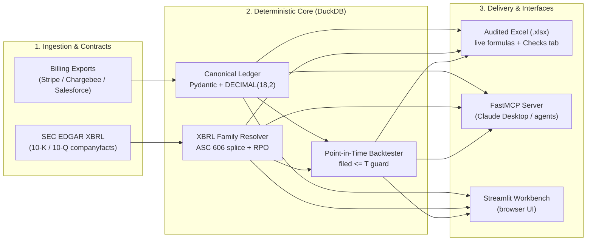

<div align="center">

# saas-metrics

**Deterministic SaaS Accounting, SEC XBRL Revenue Quality & Point-in-Time FP&A Backtesting**

[](https://pypi.org/project/saas-metrics/)
[](https://www.python.org/downloads/)
[](https://github.com/Skippy-8/saas-metrics/actions/workflows/ci.yml)
[](https://modelcontextprotocol.io/)
[](LICENSE)

**[Live demo: saas-metrics.streamlit.app](https://saas-metrics.streamlit.app/)**

[Quickstart](#quickstart) • [Why saas-metrics?](#why-saas-metrics) • [SEC XBRL Revenue Quality](#sec-xbrl-revenue-quality) • [Billing Ledger & Adapters](#billing-ledger--adapters) • [Point-in-Time Backtesting](#point-in-time-backtesting) • [MCP Server](#mcp-server-claude-desktop)

</div>

---

`saas-metrics` is a Python library, DuckDB engine, CLI, Streamlit workbench and Model Context Protocol (MCP)
server for SaaS financial analysis. It connects **bottom-up billing exports** (Stripe, Chargebee, Salesforce)
and **top-down SEC EDGAR XBRL disclosures** to audited, formula-driven Excel models: money exact to the
cent, and point-in-time guards against look-ahead bias.

## Why saas-metrics?

Standard financial scripts break on real-world SaaS accounting quirks. `saas-metrics` handles the data
engineering before a single ratio is computed:

* **No silent billing distortions:** treats Stripe's `period_end` as exclusive (so a monthly invoice is one
  month, not 31 days), stitches Salesforce renewals that lost their `ContractId`, separates contracted
  multi-year ramps from organic upsell, and writes money to DuckDB as `DECIMAL(18,2)`, reading it back to
  prove the write.
* **ASC 606 tag families:** deferred revenue and remaining performance obligations (RPO) come from ordered
  XBRL tag *families* (`ContractWithCustomerLiabilityCurrent` + `Noncurrent`, or legacy `DeferredRevenue`).
  A family counts only when every concept in it is tagged, and earlier quarters are spliced across a tag
  switch with the source family recorded per quarter.
* **True point-in-time backtesting:** each origin rebuilds quarterly SEC values from facts with
  `filed <= T` (and billing rows with `period_end <= T`); `guard_no_future` raises `LookAheadBiasError` if a
  later period leaks into a forecaster's history.
* **Formula-driven Excel output:** generated workbooks keep metrics as live formulas over blue input cells,
  and a Checks tab reads PASS only when the formulas agree with the Python engine.

---

## Quickstart

```bash
pip install "saas-metrics[web]"            # the CLI, the MCP server and the Streamlit workbench
saas-metrics sample billing.csv            # a synthetic billing export to try
saas-metrics app                           # opens the workbench in your browser
```

Or try it without installing, with [uv](https://docs.astral.sh/uv/):

```bash
# SEC XBRL revenue and cash quality comps (set SEC_USER_AGENT first, see "SEC access" below)
uvx saas-metrics quality --tickers MDB DDOG SNOW TTD

# Normalize a raw Stripe export into DuckDB and run the ARR waterfall on it
uvx saas-metrics ledger invoices.csv --adapter stripe --duckdb billing.duckdb --analyze
```

### Installation

```bash
pip install saas-metrics              # core engine + CLI (Python 3.12+)
pip install "saas-metrics[mcp]"       # + FastMCP server for Claude Desktop
pip install "saas-metrics[web]"       # + Streamlit workbench (includes the MCP server)
```

From a clone, `uv sync --extra web` installs everything and `streamlit run app.py` works too.

**Where files go.** Company configs ship inside the package. Downloads, the DuckDB store and generated
workbooks go to your user data folder (`~/Library/Application Support/saas-metrics` on macOS,
`~/.local/share/saas-metrics` on Linux, `%LOCALAPPDATA%\saas-metrics` on Windows), or to `$SAAS_METRICS_HOME`
if you set it. A source checkout keeps them in the repository's `data/` folder.

**SEC access.** Anything that downloads from SEC EDGAR (the SEC Comps tab, `benchmark`, `quality`, `fetch`)
needs a contact, as the SEC asks: set `SEC_USER_AGENT="Your Name you@example.com"` in the environment or a
`.env` file. The point-in-time backtest also needs a built store: `saas-metrics fetch` then `saas-metrics build`.

---

## Architecture



The pipeline is deliberately one-way: raw data -> validated canonical tables -> deterministic Python
-> an auditable artefact. Source values keep their filing or invoice provenance; a missing tag or an
ambiguous column remains blank and is flagged rather than guessed.

---

## SEC XBRL Revenue Quality

GAAP income statements hide SaaS momentum and equity dilution. `saas-metrics quality` takes balance-sheet
contract liabilities, RPO disclosures and cash-flow stock-based compensation from XBRL to compute
**implied billings** (revenue + the change in deferred revenue) and **SBC-adjusted free cash flow**
(CFO − capex − SBC).

Latest filed quarter, trailing four quarters, each company on its own fiscal calendar (SEC data as of
October 2026):

| Metric | MDB (Q2 FY27) | DDOG (Q2 FY26) | SNOW (Q2 FY27) | TTD (Q2 FY26) |
| :--- | ---: | ---: | ---: | ---: |
| **Revenue (TTM)** | $2,783M | $3,967M | $5,435M | $2,990M |
| **Deferred revenue (ending)** | $448M | $1,338M | $2,596M | `n/a` |
| **Implied billings (TTM)** | $2,921M *(105.0%)* | $4,308M *(108.6%)* | $5,751M *(105.8%)* | `n/a` |
| **Remaining performance obligations (RPO)** | $1,519M | $3,471M | $9,000M | `n/a` |
| **Stock-based comp (TTM / % rev)** | $564M *(20.3%)* | $823M *(20.7%)* | $1,642M *(30.2%)* | $452M *(15.1%)* |
| **SBC-adjusted FCF (TTM / margin)** | $95M *(3.4%)* | $250M *(6.3%)* | -$447M *(-8.2%)* | $397M *(13.3%)* |

### XBRL resolution rules

1. **Whole families only:** current and non-current deferred revenue must come from the same tag family.
   A half-tagged balance sheet is a blank, never a partial sum.
2. **Splices are recorded, never silent:** when a filer moves from pre-ASC 606 `DeferredRevenue` to
   `ContractWithCustomerLiability`, earlier quarters are spliced from the older family, each quarter keeps
   the family it came from, and the tag switch is reported rather than showing up as a step change.
3. **Absent stays absent:** a filer that does not tag deferred revenue or RPO (TTD) shows `n/a`, never `0`,
   which would corrupt implied billings.

### Peer comps (operating metrics)

Trailing four fiscal quarters, each company on its own fiscal calendar, from cached companyfacts:

| Ticker | Quarter | Revenue TTM | Growth YoY | Gross margin | S&M % rev | GAAP op. margin | Non-GAAP op. margin (approx.) | FCF margin | Rule of 40 |
|---|---|---|---|---|---|---|---|---|---|
| MDB | Q2 FY27 | $2,783M | 25.5% | 72.7% | 35.3% | -0.5% | 20.3% | 23.7% | 49.1% |
| DDOG | Q2 FY26 | $3,967M | 31.5% | 79.5% | 27.6% | 0.4% | 21.3% | 27.0% | 58.6% |
| SNOW | Q2 FY27 | $5,435M | 32.0% | 67.0% | 42.4% | -22.8% | 10.0% | 22.0% | 54.0% |
| TTD | Q2 FY26 | $2,990M | 11.6% | 76.9% | 22.6% | 19.6% | 34.7% | 28.4% | 40.0% |

How to read it:

- **Non-GAAP margin is approximate:** GAAP operating income plus stock-based compensation and
  amortization. The companies' own definitions exclude more.
- **TTD's gross margin is not comparable:** The Trade Desk reports no gross profit line, so its gross
  margin is computed from Platform operations.
- **Checks on every row:** each company's quarters must sum to its 10-K year, revenue minus cost must
  equal its gross profit tag where one exists, and the row must be the latest quarter filed.
- **Excel output:** ratios stay as live formulas over the TTM dollar columns.

DDOG, SNOW and TTD are benchmark-only configs: `company`, `benchmark` and nothing else. MDB and the
fictional SYNTHCO are full operating-model configs with SEC windows, drivers, cohort assumptions and
checks. The two kinds are intentionally not interchangeable.

---

## Billing Ledger & Adapters

Raw CRM and billing exports fail the waterfall identity (beginning + new + expansion − contraction − churn =
ending) unless they are normalised first. Every adapter feeds one shared pipeline: column mapping, Pydantic
contracts, FX conversion, grace-period bridging, ramp classification, proration, and (Salesforce) account
stitching.

| Adapter | Real-world trap handled out of the box |
| :--- | :--- |
| **`stripe`** | Converts cents to major units; treats `period_end` as **exclusive**, so a monthly invoice is not stretched to 31 days. |
| **`salesforce`** | Converts the TCV `Amount` into a monthly recurring amount; separates multi-year **contracted ramps** (`is_contracted_expansion`) from in-term **upsells**; stitches renewals that lost their `ContractId` by account and a grace window. |
| **`chargebee`** | Reads major-unit amounts and ISO dates; when `end_date` is blank (an open-ended term) it falls back to the billing period and flags the assumption. |

```python
from saas_metrics import engine
from saas_metrics.adapters import from_stripe_export

ledger = from_stripe_export("stripe_invoices.csv")
ledger.to_duckdb("billing.duckdb")            # money as DECIMAL(18,2), read back to verify the write

tape, notes = ledger.to_engine_input()
report = engine.analyze(tape)
report.to_excel("audited_arr_waterfall.xlsx")
```

### Why spreading matters

An annual plan invoiced in January looks like a customer who arrives in January and churns in
February. On the bundled sample export, counting invoices in the month billed produces **214 churn events**.
Spreading each invoice by day over its service period gives **106**.

Pass `--service-start` and `--service-end`, and each line is recognised evenly by day, in whole cents,
so it still sums to what was billed. Service after the export's last month is deferred and reported,
not counted.

### What it checks before computing anything

The billing engine has **24 pre-flight checks** in the full MongoDB build, and the standalone billing
path checks the same things before any table is built:

- **Errors** (always block): missing required columns, empty values, unparseable dates or amounts.
- **Warnings** (block unless `--allow-warnings`): a period with no billing at all, a customer whose
  net revenue for a period is negative, and dates in the future.
- **Info:** split invoices and credits that were netted, how many lines were spread, and coverage.

The definitions are written out in [docs/definitions.md](docs/definitions.md) and enforced by tests.
In short: New is first-ever revenue; Reactivation is revenue after a gap; Expansion, Contraction and
Churn are measured against the previous period; NRR and GRR compare a period with the same period a
year earlier; ARR is revenue times 12 at monthly grain and times 4 at quarterly grain.

---

## Point-in-Time Backtesting

### The frozen MongoDB backtest

The MongoDB model was frozen at Q2 FY26 (quarter ended July 31, 2025) using only information filed by
**2025-08-27**. It then forecast the next four quarters. Revenue over those four quarters was
**$46.8M (+1.7%)** above the frozen plan, but the quarterly path was less comfortable:

- The driver model's Base case had a **3.4%** mean absolute error; a simple trend extrapolation did
  better at **3.0%**. Management's guidance was wider still.
- Actual revenue fell inside the Downside-to-Upside range in **only one quarter**, so the scenario
  band was too narrow.
- A third baseline, a damped trend fitted only to history before the cutoff, did worse than both
  naive methods (8.3% mean absolute error): it carried the FY25 slowdown forward.
- The largest single quarterly revenue error came from the timing of Enterprise Advanced term
  licenses, which are recognised up front. Free cash flow beat the plan mainly because last year's
  same-quarter cash-conversion ratio was a poor guide.

The walking-forward harness repeats that discipline at several origins. Each origin sees only facts
filed on or before the origin date; `guard_no_future` raises `LookAheadBiasError` if a loader smuggles
in a later period. The default four-origin run scores revenue at a 1.99% MAPE with a -1.14% bias, and
FCF at a 96.45% MAPE with a +1.01% bias. Those are results from a small sample, not a claim that the
method beats a naive forecast.

The GTM case for hiring **30** Enterprise AEs pays back on its own assumptions, but those assume roughly
  2.5 times MongoDB's current sales efficiency. At the company's actual efficiency it does not pay back
within **36** months. The memo recommends a smaller pilot gated on quota attainment.

### Bring your own forecaster

Any class with `fit` and `predict` (the `BaseForecaster` protocol) can be scored without look-ahead bias. A
trailing-growth baseline in a dozen lines:

```python
from datetime import date

import pandas as pd

from saas_metrics.backtest import BaseForecaster, PointInTimeBacktester
from saas_metrics.model import quarters_after


class TrailingGrowthForecaster:
    name = "trailing_growth"

    def fit(self, historical_df: pd.DataFrame, as_of_date: date) -> None:
        # every row in historical_df was filed on or before as_of_date
        h = historical_df.sort_values("period_end").tail(5)
        self.last_end = str(h["period_end"].iloc[-1])
        self.last_revenue = float(h["revenue"].iloc[-1])
        self.growth = float(h["revenue"].pct_change().mean())           # average quarter-on-quarter growth
        self.fcf_margin = float((h["fcf"] / h["revenue"]).mean())

    def predict(self, horizon_quarters: int) -> pd.DataFrame:
        revenue = [self.last_revenue * (1 + self.growth) ** (k + 1) for k in range(horizon_quarters)]
        return pd.DataFrame({"period_end": quarters_after(self.last_end, horizon_quarters),
                             "revenue": revenue, "fcf_margin": self.fcf_margin})


assert isinstance(TrailingGrowthForecaster(), BaseForecaster)
bt = PointInTimeBacktester("MDB", forecaster=TrailingGrowthForecaster(), max_evaluations=4, horizon=4)
result = bt.run()                    # needs the MDB store: saas-metrics fetch, then saas-metrics build
print(result.summary)                # MAPE and bias per metric; result.bridges holds the variance bridges
```

Full-model configs (MDB, and the fictional SYNTHCO used in tests) can be backtested. DDOG, SNOW and TTD
are benchmark-only configs for the comps above.

---

## The Workbench

Live at **[saas-metrics.streamlit.app](https://saas-metrics.streamlit.app/)**. The hosted copy shows the first two tabs; the backtest tab appears wherever a company store has been built.

The Streamlit app is a thin UI over the library, not a second implementation:

| Tab | What it does |
|---|---|
| **SaaS SEC Comps** | Multiselect DDOG / SNOW / MDB by default, then call `quality.table`: deferred revenue, implied billings, RPO, SBC and SBC-adjusted FCF. |
| **ARR Waterfall & Cohort Retention** | Upload a Stripe, Salesforce or Chargebee CSV; run the Phase 1 adapter; see row count, current MRR (ending ARR / 12), starting and ending ARR, a cohort ARR chart, and download the audited `.xlsx`. |
| **Point-in-Time Backtest Arena** | Run `PointInTimeBacktester` at several historical origins, then read the MAPE / bias scorecard and the 1Q and full-horizon variance bridges. Shown once a company store is built. |

Every upload passes the adapter's pre-flight checks before a number appears. A failed row is shown,
not silently dropped; a warning is surfaced beside the summary.

---

## MCP Server (Claude Desktop)

Expose deterministic SaaS accounting and SEC XBRL extraction to Claude Desktop or any MCP-compatible agent,
so the numbers come from tested code rather than from the model.

Add to `claude_desktop_config.json` (on macOS, `~/Library/Application Support/Claude/claude_desktop_config.json`):

```json
{
  "mcpServers": {
    "saas-metrics": {
      "command": "uvx",
      "args": ["--from", "saas-metrics[mcp]", "saas-metrics", "mcp"],
      "env": {
        "SEC_USER_AGENT": "Your Name you@example.com"
      }
    }
  }
}
```

**Exposed MCP tools:**
* `ingest_billing_ledger(export_path, adapter, db_path)`
* `generate_cohort_report(output_filename, grain, db_path)`
* `run_sec_peer_benchmark(tickers, quarters_back, as_of)`
* `analyze_revenue_quality(tickers, as_of)`

Ingested ledgers go to `data/billing.duckdb` under the work root unless `SAAS_METRICS_LEDGER_DB` names another
file. If Claude Desktop does not inherit your shell `PATH`, use the absolute path to `uvx` (run `which uvx`).
From a source checkout, use `command: "uv"` and
`args: ["run", "--directory", "/absolute/path/to/saas-metrics", "saas-metrics", "mcp"]`.

---

## CLI

```bash
# Billing: canonical ledger, waterfall, retention and an audited workbook
saas-metrics sample billing.csv
saas-metrics ledger billing.csv --adapter stripe --duckdb billing.duckdb --analyze
saas-metrics report billing.csv --customer "Customer" --date "Invoice Date" --amount "Amount" \
    --service-start "Service Start" --service-end "Service End" --segment "Plan Tier" --channel "Channel" \
    --excel metrics.xlsx --out tables/

# SEC XBRL and revenue quality
saas-metrics benchmark --tickers MDB DDOG SNOW TTD
saas-metrics quality --tickers MDB DDOG SNOW TTD --out quality.xlsx

# Cohorts and the point-in-time harness
saas-metrics cohorts --input billing.csv --out out/
saas-metrics cohorts --ledger MDB
saas-metrics backtest
saas-metrics backtest --pit --horizon 4 --evaluations 4

# Full operating model (MDB is the default config)
saas-metrics --config configs/MDB.yaml fetch
saas-metrics --config configs/MDB.yaml build
saas-metrics --config configs/MDB.yaml qc
saas-metrics --config configs/MDB.yaml workbook
saas-metrics --config configs/MDB.yaml backtest
saas-metrics --config configs/MDB.yaml memo

# MCP server
saas-metrics mcp
```

The legacy `saasfpa` entry point is still installed:

```bash
saasfpa benchmark --tickers MDB DDOG SNOW TTD
saasfpa cohorts --input billing.csv --out out/
saasfpa unit-econ --n-ae 20 --rep-attrition 0.25 --target-payback 24
```

## Reproducing the tests

Python 3.12 and [uv](https://docs.astral.sh/uv/).

```bash
make install
make test
ruff check src tests scripts
```

The test suite is offline: the DuckDB store is rebuilt from parsed SEC tables in `tests/fixtures`,
companyfacts come from frozen fixtures, and billing examples are synthetic. The only network marker is
`network`, which is excluded from the default run.

## Layout

```
app.py                 launches the workbench (src/saas_metrics/app.py) for `streamlit run` / Streamlit Cloud
configs/               one YAML per company (MDB full model; DDOG, SNOW, TTD benchmark; examples/SYNTHCO);
                       shipped inside the wheel as saas_metrics/configs
src/saas_metrics/      engine, adapters, SEC/XBRL, quality, backtest, FastMCP server, the Streamlit workbench
src/saasfpa/           the legacy compatibility package
src/saas_metrics/sql/  analytical views, the billing engine's and the cohort engine's SQL
tests/                 offline tests, fixtures and the golden snapshot
models/                the audited Excel operating model
memos/                 memo template and rendered memo
docs/                  definitions and the generated sources page
```

## Limitations

- One real company and four test quarters are enough to diagnose this forecast, not to claim the
  method is generally better than a naive one. On this sample, quarter by quarter, it was not.
- The ARR proxy is not MongoDB's disclosed ARR, and the cohort panel is synthetic; splits that depend
  on the assumed churn rate are directional.
- Headcount is disclosed once a year, so the split between hiring pace and cost per head is uncertain
  for the latest quarters, though their sum is exact.
- The bridge attribution depends on the substitution order.
- Peer comps use each company's XBRL tags as filed. A changed or missing tag is caught by the checks or
  the notes, but definitions still differ between companies.

The sample data is synthetic. The licence is MIT.
